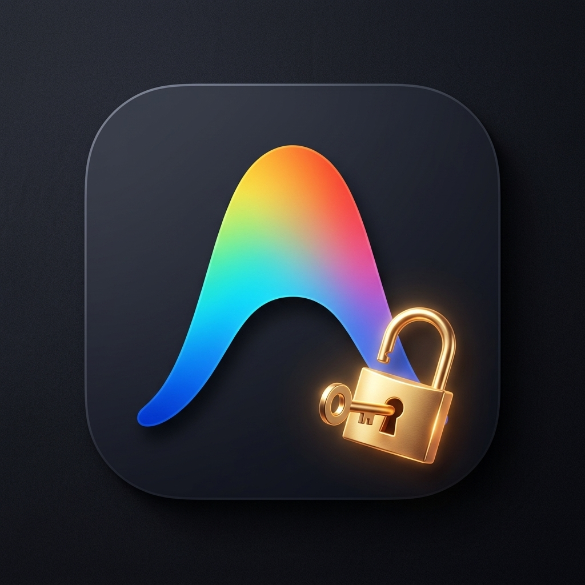
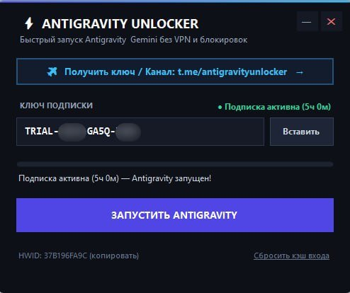

# ANTIGRAVITY UNLOCKER

### ⚡ Разблокировка Google Antigravity & Gemini в России и РБ в 1 клик
**Без глобального VPN • Без смены страны Google-аккаунта • С живым мониторингом отклика**

[-0078D4?style=flat-square&logo=windows&logoColor=white)](#-%D0%B1%D1%8B%D1%81%D1%82%D1%80%D1%8B%D0%B9-%D1%81%D1%82%D0%B0%D1%80%D1%82)

 

[-2AABEE?style=for-the-badge&logo=telegram&logoColor=white)](https://t.me/antigravityunlocker)

  <a href="#-%D1%87%D1%82%D0%BE-%D1%8D%D1%82%D0%BE-%D1%82%D0%B0%D0%BA%D0%BE%D0%B5">О программе</a> •
  <a href="#-%D1%81%D1%80%D0%B0%D0%B2%D0%BD%D0%B5%D0%BD%D0%B8%D0%B5-%D1%81%D0%BF%D0%BE%D1%81%D0%BE%D0%B1%D0%BE%D0%B2">Преимущества</a> •
  <a href="#-%D0%B1%D1%8B%D1%81%D1%82%D1%80%D1%8B%D0%B9-%D1%81%D1%82%D0%B0%D1%80%D1%82">Быстрый старт</a> •
  <a href="#-%D0%BA%D0%B0%D0%BA-%D1%8D%D1%82%D0%BE-%D1%80%D0%B0%D0%B1%D0%BE%D1%82%D0%B0%D0%B5%D1%82">Как это работает</a> •
  <a href="#-%D1%87%D0%B0%D1%81%D1%82%D0%BE-%D0%B7%D0%B0%D0%B4%D0%B0%D0%B2%D0%B0%D0%B5%D0%BC%D1%8B%D0%B5-%D0%B2%D0%BE%D0%BF%D1%80%D0%BE%D1%81%D1%8B-faq">FAQ</a>

---

## 💡 Что это такое

**Antigravity Unlocker (`1-Click Fixer`)** — удобный графический лаунчер для Windows, который полностью устраняет региональные блокировки и ошибки доступа (**`Sorry, this account is ineligible to use Antigravity`**, **`Location not supported`**, **`Error 403`**, **`ERR_NO_SUPPORTED_PROXIES`**, бесконечный **`Working`**) в **Google Antigravity**, **Antigravity IDE**, **Gemini** и **Antigravity CLI (`agy`)**.

Вам **больше не нужно**:
- Менять страну своего основного Google-аккаунта или регистрировать зарубежные почты;
- Выключать свой привычный VPN (программа стабильно работает даже поверх включённого режима **TUN**);
- Возиться с консольными скриптами, ручной правкой `hosts`, DNS и конфигов;
- Страдать от обрывов длинных стримов агента и просадки скорости в играх или браузере.

 

  

---

## 📊 Сравнение способов

| Возможность | Обычный VPN | Консольные DNS-скрипты | **Antigravity Unlocker** |
| :--- | :---: | :---: | :---: |
| **Запуск в 1 клик (GUI)** | ⚠️ Нужна настройка | ❌ Терминал / скрипты | ✅ **Удобное приложение** |
| **Снятие `Account is ineligible` (РФ/РБ)** | ❌ Не снимает на РФ-аккаунтах | ✅ Да | ✅ **Автоматический патч** |
| **Работа вместе с включённым TUN-VPN** | ❌ Конфликты маршрутов | ❌ Часто ломается | ✅ **Прямой обход мимо TUN** |
| **Скорость основного интернета и игр** | ❌ Падает весь трафик | ✅ Не влияет | ✅ **100% скорость провайдера** |
| **Живой мониторинг ответов ИИ** | ❌ Нет | ❌ Нет | ✅ **Таймер отклика и пинг** |

---

## 🚀 Быстрый старт

1. Скачайте готовый лаунчер **[`AGUNLOCKER.exe`](https://github.com/antigravityunlocker/antigravity-unlocker/releases/latest/download/AGUNLOCKER.exe)** (установка не требуется, один портативный файл ~190 КБ).
2. Откройте Telegram-канал **[t.me/antigravityunlocker](https://t.me/antigravityunlocker)** и скопируйте **бесплатный пробный ключ на 5 часов** (или оформите подписку).
3. Запустите `AGUNLOCKER.exe`, нажмите **«Вставить»** и кнопку **«Активировать и запустить»**.
4. Antigravity откроется автоматически, а окно анлокера переключится в режим **живого мониторинга** отклика серверов Google.

> [!TIP]
> **Уведомление Windows SmartScreen:**  
> При первом запуске Windows может показать стандартное окно фильтра SmartScreen для новых утилит без цифровой подписи Microsoft. Нажмите **«Подробнее» → «Выполнить в любом случае»**.

---

## ⚙️ Как это работает

- **Точечный локальный релей (без глобального прокси):**  
  Программа поднимает фоновый локальный шлюз исключительно для процессов `Antigravity.exe` и `language_server.exe`. Системный прокси Windows, браузеры, игры и мессенджеры **не затрагиваются**.
- **Автоматический Eligibility-патч:**  
  Перед стартом снимается внутренняя проверка региона аккаунта в ядре `language_server` и `agy` (с автоматическим сохранением резервной копии `.orig.bak`), поэтому подходят обычные российские и белорусские Google-аккаунты.
- **Умный обход TUN и защита стримов (Keep-Alive):**  
  Лаунчер автоматически прокладывает прямой маршрут через физический адаптер (Wi-Fi / Ethernet), исключая двойное туннелирование и разрывы соединения при включении/выключении сторонних VPN (Hiddify, v2rayN, Amnezia, Clash, WireGuard).
- **Панель живого контроля:**  
  В реальном времени отображает, сколько секунд назад ответил сервер Antigravity, статус фонового релея и текущий пинг до серверов Google AI.

---

## 🧩 Поддерживаемые компоненты

- **Google Antigravity 2.0 (Hub)** — основное десктопное приложение;
- **Antigravity IDE** — автономная среда разработки;
- **Ядро `language_server.exe`** — все модели Gemini и Claude внутри Antigravity;
- **Antigravity CLI (`agy.exe`)** — консольный агент.

---

## ❓ Часто задаваемые вопросы (FAQ)

<b>1. Где взять бесплатный ключ на проверку?</b>

В нашем официальном Telegram-канале <b><a href="https://t.me/antigravityunlocker">t.me/antigravityunlocker</a></b> опубликован общий промо-ключ — он даёт <b>5 часов полной работы бесплатно</b> на каждом новом ПК.

<b>2. Нужно ли выключать мой основной VPN (Hiddify / v2rayN / Amnezia)?</b>

<b>Нет, не нужно.</b> Antigravity Unlocker корректно работает как полностью без VPN, так и параллельно с включённым VPN в режиме TUN или системного прокси.

<b>3. Можно ли закрыть или свернуть окно анлокера после запуска Antigravity?</b>

<b>Да.</b> Сетевой релей работает в отдельном скрытом фоновом процессе до тех пор, пока открыт Antigravity. Окно мониторинга можно спокойно свернуть или закрыть.

<b>4. Что делать, если осталась старая ошибка входа с прошлых запусков?</b>

В правом нижнем углу окна <code>AGUNLOCKER.exe</code> нажмите ссылку <b>«Сбросить кэш входа»</b> и затем кнопку запуска — программа очистит закэшированный статус сессии.

<b>5. Замедлится ли мой обычный интернет, YouTube, Discord или игры?</b>

<b>Нет.</b> Программа не меняет системный прокси Windows и не перехватывает трафик других приложений — ускоренный канал в Германии используется только самим Antigravity.

---

**Официальный канал, обновления и ключи доступа:**  
### [✈ t.me/antigravityunlocker](https://t.me/antigravityunlocker)

